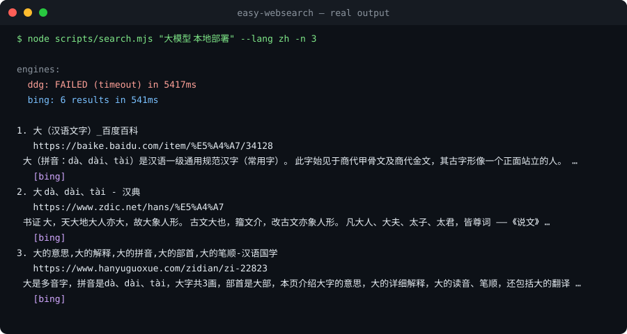

# easy-websearch

[English](README.md) | [简体中文](README.zh-CN.md)

[](https://github.com/xinghe-labs/easy-websearch/actions/workflows/engine-probe.yml)
[](https://github.com/xinghe-labs/easy-websearch/releases)
[](https://www.npmjs.com/package/easy-websearch)
[](https://www.npmjs.com/package/easy-websearch)
[](LICENSE)


Multi-engine web search + page reader for AI coding agents — as a single
[Agent Skills](https://agentskills.io)-compatible skill folder.

**Zero-config**: works with no API key at all (DuckDuckGo + Bing baseline).
**Better with keys**: set any of 11 optional keys (Brave, Tavily, Serper, Exa,
Firecrawl, Bocha, Metaso, Linkup, Ollama, AnySearch, Keenable — see the
[engine keys table](#engine-keys-all-optional)) and those engines join the
pool automatically. Failing engines get a 10-minute cooldown so one bad
engine never burns the whole request.

```text
query ──► [ ddg ] [ bing ] [ baidu ] [ brave ] [ tavily ] [ serper ] [ exa ]
              │        │        │        │        │         │        │
              └──────── per-engine timeout, independent failover ────────┘
                 [+ firecrawl, bocha, metaso, linkup, ollama, searxng w/ keys]
                              ▼
              Reciprocal Rank Fusion + URL dedup
                              ▼
            ranked results, engine attribution, JSON output
```

Plus keyless backups (AnySearch, Keenable, Sogou Weixin) for when the
baselines degrade, a `doctor` self-check command, and a failure cooldown.

## Quick start

**1. Install** — either as an agent skill (into Claude Code and any
Agent-Skills agent):

```bash
npx skills add xinghe-labs/easy-websearch
```

…or as a standalone global CLI:

```bash
npm install -g easy-websearch
```

**2. Verify** (optional but recommended — no API key needed for this):

```bash
easy-websearch doctor                                    # npm install path
node ~/.agents/skills/easy-websearch/scripts/doctor.mjs  # skills add path
```

**3. Use it** — talk to your agent, or run the CLI. No configuration, no
flags to remember:

> “帮我查一下 rust async runtime 的最新资料” · “search for the latest webgpu news” · “读一下这个网页讲了什么：https://…”

```bash
easy-websearch search "大模型 本地部署" --lang zh -n 5
```

That's it — the baseline (DuckDuckGo + Bing + Baidu) works with zero API
keys; optional keys upgrade the pool automatically (see
[Engine keys](#engine-keys-all-optional)).

## Why easy-websearch

| | built-in web tools | single-engine skills | **easy-websearch** |
|---|---|---|---|
| Works with no API key | agent-dependent | often not | ✅ DDG + Bing + Baidu baseline |
| Survives engine blocks/rate limits | n/a | ❌ single point of failure | ✅ failover + fusion + cooldown |
| Chinese sources | varies | rarely tuned | ✅ `cn-zh` / `zh-CN` region tuning, Baidu + CSDN/知乎/juejin reachable |
| Tells you *which* engines answered | no | no | ✅ per-engine status + per-hit attribution |
| Runtime deps | — | often npm/pip | ✅ zero (Node ≥18 **or** Python ≥3.11 stdlib) |
| Proxy-aware | varies | rarely | ✅ honors `HTTPS_PROXY` (incl. a CONNECT tunnel for Node `fetch`) |

<p align="center"></p>

## Install

Two install shapes — pick per use case (both can coexist):

### As an agent skill (for Claude Code / Codex / Cursor / Gemini CLI…)

The agent then searches automatically whenever you ask it to.

```bash
# skills CLI (re-running updates in place)
npx skills add xinghe-labs/easy-websearch

# or clone directly
git clone https://github.com/xinghe-labs/easy-websearch ~/.claude/skills/easy-websearch
```

> Behind the GFW? Direct GitHub access can be flaky — the **npm route**
> (`npm install -g easy-websearch`) never touches GitHub and is the most
> reliable install path there.

### As a global CLI (for your own terminal)

```bash
npm install -g easy-websearch
```

Gives you the `easy-websearch` command everywhere — search / fetch / doctor /
setup as subcommands. Or run without installing: `npx easy-websearch@latest doctor`

```bash
easy-websearch search "大模型 本地部署" --lang zh -n 5
easy-websearch fetch "https://example.com/article"
easy-websearch research "compare local LLM deployment options" --json
easy-websearch doctor
```

### Engine keys (all optional)

Every key is optional. Add one and its engine joins the search pool
automatically. Fastest wins first:

| Order | Engine | What it adds | Free | Sign up (direct link) | Env var |
|---|---|---|---|---|---|
| 1 | **Brave** | stable international results | 2,000/mo | [brave.com/search/api](https://brave.com/search/api/) → Free plan | `BRAVE_API_KEY` |
| 2 | **Tavily** | LLM-friendly summaries | 1,000/mo | [app.tavily.com](https://app.tavily.com/) | `TAVILY_API_KEY` |
| 3 | **Ollama** | one more solid source | free account | [ollama.com](https://ollama.com/) → Account → API keys | `OLLAMA_API_KEY` |
| 4 | **Bocha 博查** | best Chinese web results | grant (paid) | [open.bochaai.com](https://open.bochaai.com/) | `BOCHA_API_KEY` |
| 5 | **Serper** | Google results | trial | [serper.dev](https://serper.dev/) | `SERPER_API_KEY` |
| 6 | **Exa** | semantic search | trial | [dashboard.exa.ai](https://dashboard.exa.ai/) | `EXA_API_KEY` |
| 7 | **Firecrawl** | search + better `fetch` | trial | [firecrawl.dev](https://firecrawl.dev/) | `FIRECRAWL_API_KEY` |
| 8 | **Metaso 秘塔** | Chinese AI search | grant (paid) | [metaso.cn/search-api/api-keys](https://metaso.cn/search-api/api-keys) | `METASO_API_KEY` |
| 9 | **Linkup** | sourced answers | free tier | [linkup.so](https://linkup.so/) | `LINKUP_API_KEY` |
| — | AnySearch / Keenable | keyless backups (opt-in) | anonymous OK | [anysearch.com](https://anysearch.com/) / [keenable.ai](https://keenable.ai/) | `ANYSEARCH_API_KEY` / `KEENABLE_API_KEY` |

Put keys in your agent's env (e.g. Claude Code `~/.claude/settings.json`):

```json
{ "env": { "BRAVE_API_KEY": "…", "TAVILY_API_KEY": "…" } }
```

Then `easy-websearch doctor` (or `node scripts/doctor.mjs`) — each missing
key prints where to get it.

## Self-hosted SearXNG (unlimited, no keys)

Full deployment guide (docker-compose, settings.yml, remote servers, NAT,
network gotchas): [`docs/searxng-setup.md`](docs/searxng-setup.md).

If you run [SearXNG](https://docs.searxng.org/) yourself (docker one-liner:
`docker run -p 8080:8080 searxng/searxng`), point the skill at it:

```bash
export SEARXNG_BASE_URL=http://localhost:8080   # or https://searx.example.com
```

The `searxng` engine joins the pool automatically. Two requirements on the
instance side:

1. **JSON format enabled** — in `settings.yml`:
   ```yaml
   search:
     formats:
       - html
       - json
   ```
   (If it's missing, doctor/search reports: `SearXNG rejected JSON — add
   'json' to search.formats in settings.yml`.)
2. **Reachability** — the skill honors `HTTPS_PROXY`; a local instance should
   be reachable directly.

A private instance gives you an unlimited engine with no API keys and no
rate limits — a clean alternative to sharing accounts.

## Research mode

Multi-round evidence collection (the agent writes the answer):

```bash
easy-websearch research "compare local LLM deployment options" --json
```

Decomposes into sub-queries → parallel search → fetches top pages → outputs
a structured evidence pack with cross-hit annotations. The agent reads this
and writes the cited answer.

## Usage

The agent runs these itself when you ask it to search; you can also run them directly.

```bash
# search (Node or Python — both included, zero deps)
node scripts/search.mjs "large language model local deployment" --lang zh -n 5
python3 scripts/search.py "fusion reactor progress 2026" --days 30

# filters
node scripts/search.mjs "webgpu tutorial" --site developer.mozilla.org --exclude-site pinterest.com

# machine-readable
node scripts/search.mjs "qwen3 benchmarks" --json

# read a page as Markdown (auto-falls back to r.jina.ai if blocked)
node scripts/fetch.mjs "https://example.com/some/article"
```

Example output (text mode):

```text
engines:
  ddg: 10 results in 1214ms
  bing: 10 results in 786ms

1. 大模型本地部署保姆级教程 ...
   https://blog.csdn.net/...
   本文分享大模型本地部署基础知识...
   [bing, ddg]          ← hit by both engines ⇒ ranked first
```

## How fusion works

Each engine returns a ranked list. A URL found at rank *r* by an engine
contributes `1/(60+r)` to its score (Reciprocal Rank Fusion). Scores are
summed across engines after URL normalization (tracking params stripped,
Bing `/ck/a` and DDG `/l/?uddg=` redirects decoded), so pages that
*multiple independent engines* agree on rise to the top.

Failure is expected and handled: any engine can time out, get rate-limited,
or serve an anti-bot page — its status is reported, it enters a 10-minute
cooldown (skipped on subsequent default runs; override with `--engine` or
`--no-cooldown`), and fusion proceeds with the rest. If *all* engines fail,
you get their error messages, not silence.

## Health check & troubleshooting

```bash
easy-websearch doctor          # per-engine status, latency, config gaps
node scripts/doctor.mjs        # same, from a skill folder
python3 scripts/doctor.py --json
```

**An engine says `skipped (cooldown: ...)`** — it failed recently (timeout,
bot-block, bad key). Failing engines are skipped for 10 minutes on default
searches so they don't burn every request. State lives in
`$XDG_CACHE_HOME/easy-websearch/cooldowns.json` (`~/.cache/...` by default).
Reset it with `easy-websearch doctor --clear-cooldown`, bypass per-run with
`--no-cooldown`, or name the engine explicitly (`--engine ddg`).

**DDG fails with timeout / HTTP 202** — DuckDuckGo blocks some networks.
Bing stays reachable from most networks; setting `HTTPS_PROXY` also helps
(both runtimes honor it).

**Bing says `bot junk detected`** — Bing served an anti-bot page disguised
as results. The guard failed the engine soft so other engines cover; retry
later or use a keyed engine.

## Requirements

- Node ≥ 18 (`scripts/*.mjs`) or Python ≥ 3.11 (`scripts/*.py`) — one is enough
- Outbound HTTPS. Behind a proxy? Set `HTTPS_PROXY`; both runtimes honor it.

## Known limits (honesty section)

- Baseline HTML scraping (DDG/Bing) can break when engines change markup —
  CI re-probes engines weekly and opens an issue when one dies.
- `--days` is approximate on DDG (day/week/month granularity) and not
  supported by Bing HTML.
- Baidu/Sogou anti-bot pages are fingerprint-sensitive: the node runtime
  passes consistently; the python runtime may intermittently hit
  verification pages — those engines fail soft and other engines cover.
- Deep-research multi-step workflow docs land in v2
  (`references/deep-research.md`).

## License

MIT
