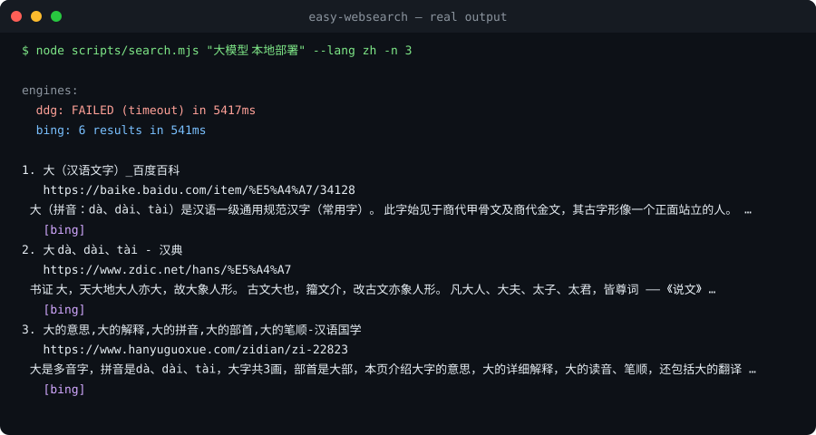

# easy-web-search（中文说明）

> 面向 AI 编程 agent 的多引擎网页搜索 + 网页正文读取，单文件夹即是一个
> [Agent Skills](https://agentskills.io) 标准技能。

[English](README.md) | 简体中文

**零配置**：不配任何 API key 也能用（DuckDuckGo + Bing 基线）。
**配 key 更强**：设置 `BRAVE_API_KEY`、`TAVILY_API_KEY`、`SERPER_API_KEY`、
`EXA_API_KEY`、`FIRECRAWL_API_KEY`、`BOCHA_API_KEY`、`METASO_API_KEY`、
`LINKUP_API_KEY`、`OLLAMA_API_KEY` 后对应引擎自动加入。另有两个免 key 备援
引擎（AnySearch、Keenable），通过 `EASY_WEB_SEARCH_ENGINES=anysearch,keenable`
按需启用。失败的引擎会进入 10 分钟冷却期，单个坏引擎不会拖垮整个请求。

```text
查询 ──► [ ddg ] [ bing ] [ brave ] [ tavily ] [ serper ] [ exa ]
              │        │        │        │         │        │
              └──── 单引擎超时，独立降级互不影响 ────┘
                 ［配 key 后自动加入：firecrawl / bocha / metaso / linkup / ollama］
                              ▼
                RRF 倒数排名融合 + URL 去重
                              ▼
          排序结果、来源引擎标注、JSON 结构化输出
```

另有免 key 备援引擎（AnySearch、Keenable）在基线降级时兜底，
以及 `doctor` 自检命令和失败冷却机制。

<p align="center"></p>

## 为什么选 easy-web-search

| | agent 内置搜索 | 单引擎类 skill | **easy-web-search** |
|---|---|---|---|
| 无 API key 可用 | 看 agent 脸色 | 通常不行 | ✅ DDG + Bing 基线 |
| 引擎被反爬/限流时 | 不可控 | ❌ 单点故障 | ✅ 自动降级 + 多源融合 |
| 中文信息源 | 不稳定 | 很少调优 | ✅ `cn-zh` / `zh-CN` 区域调优，CSDN/知乎/掘金可达 |
| 告诉你哪些引擎答了 | 否 | 否 | ✅ 每引擎状态 + 每条结果来源标注 |
| 运行时依赖 | — | 常 npm/pip | ✅ 零依赖（Node ≥18 **或** Python ≥3.11 标准库） |
| 代理感知 | 不一定 | 很少 | ✅ 读取 `HTTPS_PROXY`（Node 内置 CONNECT 隧道） |

## 安装

### Claude Code / 任何支持 Agent Skills 的工具

把本文件夹放进 skills 目录即可（重复执行 add 命令会原地更新已装版本）：

```bash
# 用户级
git clone https://github.com/xinghe-labs/easy-websearch ~/.claude/skills/easy-websearch

# 或项目级
git clone https://github.com/xinghe-labs/easy-websearch .claude/skills/easy-websearch
```

用 [skills CLI](https://skills.sh)：

```bash
npx skills add xinghe-labs/easy-websearch
```

验证安装：

```bash
node scripts/doctor.mjs    # 每个引擎：可达 / 缺 key / 冷却中
```

### 可选的 key 增强

| 环境变量 | 引擎 | 免费额度 | 申请地址 |
|---|---|---|---|
| `BRAVE_API_KEY` | Brave Search | 2,000 次/月 | brave.com/search/api |
| `TAVILY_API_KEY` | Tavily | 1,000 次/月 | tavily.com |
| `SERPER_API_KEY` | Google（Serper） | 试用额度 | serper.dev |
| `EXA_API_KEY` | Exa（语义搜索） | 试用额度 | exa.ai |
| `FIRECRAWL_API_KEY` | Firecrawl | 试用额度；同时升级 fetch 抓取 | firecrawl.dev |
| `BOCHA_API_KEY` | 博查（中文搜索） | 付费，有免费额度 | open.bochaai.com |
| `METASO_API_KEY` | 秘塔（中文 AI 搜索） | 付费，有免费额度 | metaso.cn/search-api |
| `LINKUP_API_KEY` | Linkup | 免费额度 | linkup.so |
| `OLLAMA_API_KEY` | Ollama 网页搜索 | 免费账号 | ollama.com |
| `ANYSEARCH_API_KEY` | AnySearch | 可不填——匿名限速可用 | anysearch.com |
| `KEENABLE_API_KEY` | Keenable | 可不填——匿名限速可用 | keenable.ai |

全部可选，基线引擎什么都不用配。两个免 key 备援引擎不进默认搜索（匿名配
额低），用 `--engine anysearch,keenable` 或
`EASY_WEB_SEARCH_ENGINES=anysearch,keenable` 启用。

## 用法

```bash
# 搜索（Node / Python 双实现，均零依赖）
node scripts/search.mjs "大模型 本地部署" --lang zh -n 5
python3 scripts/search.py "fusion reactor progress 2026" --days 30

# 过滤参数
node scripts/search.mjs "webgpu 教程" --site developer.mozilla.org --exclude-site pinterest.com

# 结构化输出（供 agent 二次处理）
node scripts/search.mjs "qwen3 评测" --json

# 读网页正文为 Markdown（被反爬时自动降级到 r.jina.ai）
node scripts/fetch.mjs "https://example.com/some/article"
```

输出示例（文本模式）：

```text
engines:
  ddg: 10 results in 1214ms
  bing: 10 results in 786ms

1. 大模型本地部署保姆级教程 ...
   https://blog.csdn.net/...
   本文分享大模型本地部署基础知识...
   [bing, ddg]          ← 双引擎同时命中 ⇒ 排名靠前
```

## 融合排序原理

每个引擎返回自己的排名列表。某 URL 在某引擎排第 *r* 名，就贡献
`1/(60+r)` 分（RRF 倒数排名融合）。URL 先做归一化（去跟踪参数、解码
Bing `/ck/a` 和 DDG `/l/?uddg=` 跳转），跨引擎累加后排序——**多个独立
引擎都认可的页面自然浮到顶部**。

失败是预期内的：任何引擎都可能超时、被限流或吃到反爬页——它的状态会被
如实标注，并进入 10 分钟冷却（后续默认运行自动跳过；用 `--engine` 或
`--no-cooldown` 可强制重试），融合继续用剩下的源。全部引擎都失败时，你
会拿到各引擎的错误信息，而不是沉默。

## 健康自检

```bash
node scripts/doctor.mjs        # 每引擎状态、延迟、配置缺失一目了然
python3 scripts/doctor.py --json
```

## 故障排查

**某引擎显示 `skipped (cooldown: ...)`** —— 它最近失败过（超时/反爬/key 错误）。
失败引擎会在后续默认搜索中被跳过 10 分钟，避免每次都白烧请求。状态存在
`$XDG_CACHE_HOME/easy-websearch/cooldowns.json`（默认 `~/.cache/...`）。
用 `node scripts/doctor.mjs --clear-cooldown` 重置；单次用 `--no-cooldown`
绕过；或显式点名引擎（`--engine ddg`）。

**DDG 超时 / HTTP 202** —— DuckDuckGo 封锁部分网络。Bing 在多数网络可达；
设置 `HTTPS_PROXY` 也有帮助（两个运行时都会遵守）。

**Bing 提示 `bot junk detected`** —— Bing 返回了伪装成结果的反爬页。护栏
已让该引擎软失败、其他引擎接管；稍后重试或改用配 key 的引擎。

## 环境要求

- Node ≥ 18（`scripts/*.mjs`）或 Python ≥ 3.11（`scripts/*.py`）——有其一即可
- 能出网。走代理？设好 `HTTPS_PROXY`，两个运行时都会遵守。

## 已知边界（如实说明）

- 基线 HTML 解析（DDG/Bing）在引擎改版时会失效——CI 每周探测并自动开
  issue，通常在用户撞上之前就能发现
- `--days` 在 DDG 上是近似值（日/周/月粒度），Bing HTML 不支持
- SearXNG 公共实例因不稳定被评估后放弃（见 `references/engine-notes.md`）；
  自建 SearXNG 支持在路线图上
- 深度研究工作流文档在 v2 落地（`references/deep-research.md`）

## 许可证

MIT
